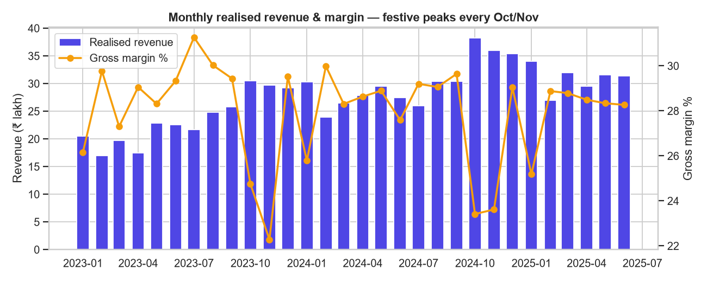
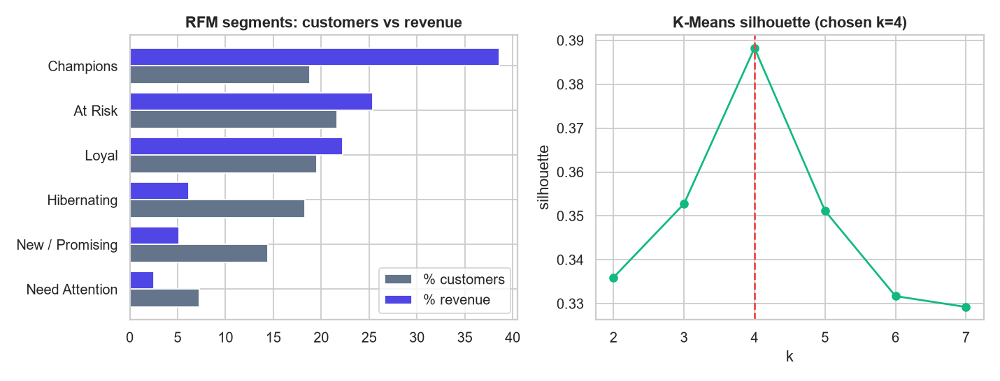
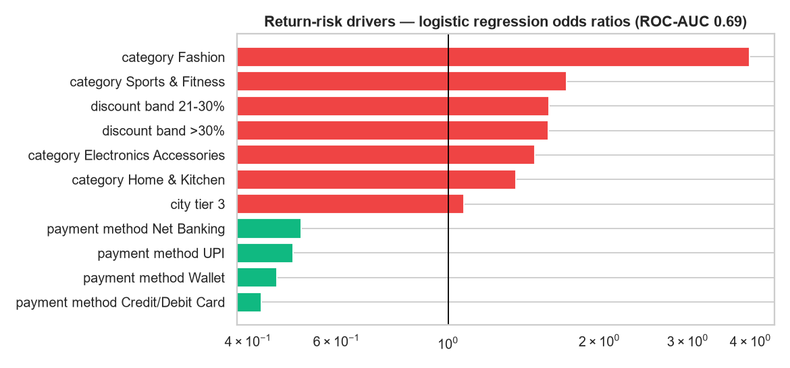
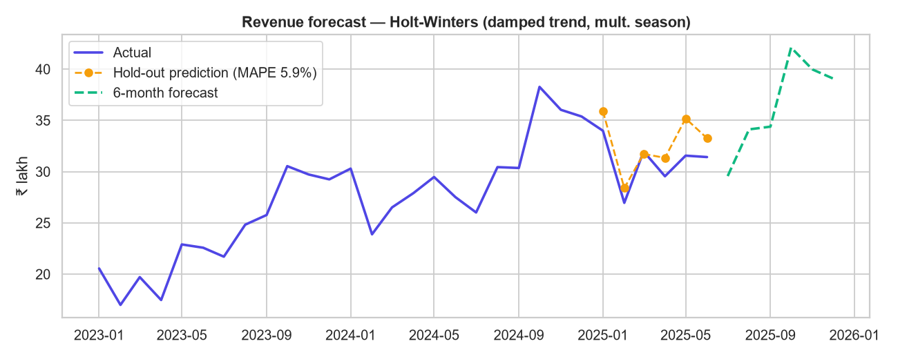

# 📊 Retail Sales & Customer Analytics

End-to-end data analyst project on **~60,000 order lines** from an Indian direct-to-consumer e-commerce brand
(Jan 2023 – Jun 2025): messy raw exports → cleaned star schema → SQL → statistics & machine learning →
**interactive Streamlit dashboard** and an **auto-generated PDF report**.

 
 


[](https://siva-retail-sales-analytics.streamlit.app)

| | |
|---|---|
| **Live dashboard** | https://siva-retail-sales-analytics.streamlit.app |
| **Streamlit account** | [sivasankarthirumalasetty](https://share.streamlit.io/user/sivasankarthirumalasetty) |
| **GitHub repository** | https://github.com/SivaSankarThirumalasetty/retail-sales-analytics |
| **Report (PDF)** | [`reports/Technical_Contribution_Report.pdf`](reports/Technical_Contribution_Report.pdf) |

---

## Business questions

1. How are revenue, margin and order volume trending, and how strong is festive seasonality?
2. Which categories, cities and acquisition channels create the most **profit**, not just revenue?
3. How well do we retain customers (cohort retention), and who are our most valuable customers?
4. What drives product **returns**, and how much do discounts really cost us?
5. What revenue should we plan for over the next six months?

## Headline results

| Metric | Value |
|---|---|
| Realised revenue (after returns) | ₹8.30 Cr |
| Orders / customers | 35,892 / 10,209 |
| Average order value | ₹2,311 |
| Gross margin | 27.8% |
| Return rate | 11.1% |
| H1-2025 YoY growth | +12.0% |
| Avg. M3 cohort retention | 22.9% |
| Forecast hold-out MAPE | **5.85%** (seasonal-naive baseline 10.66%) |

**Key insights**

- **Discounts above 20% are loss-making.** Profit per line drops from ₹593 (no discount) to ₹105 (21–30%) and
  **–₹44** (>30%), and returns rise from ~10.5% to ~14.7%.
- **COD lines return at 16.7% vs 9.6% for UPI.** Every prepaid method roughly halves the odds of a return.
- **Top 20% of customers = 57% of revenue.** "Champions" are 19% of customers but 39% of revenue.
- **Referral and Organic customers are worth ~1.8× more** in their first 12 months than Marketplace or Paid Social
  customers (₹11.8k / ₹10.5k vs ₹6.1k / ₹6.6k).
- **Electronics is 36% of revenue at only 18% margin**; Fashion has a 42% margin but a 21% return rate.

## Architecture

```
generate_data.py ──► clean.py ──────────► run_sql.py ─────────► analysis.py ─────────► app.py (Streamlit)
 seeded simulator    dedupe, parse dates,  SQLite star schema,    KPIs, cohorts, RFM,     build_report.py (PDF)
 + injected dirt     fix currency/cities,  CTEs + window funcs,   K-Means, logistic       metrics.json
                     validate, star schema 7 business queries     regression, Holt-Winters
data/raw/*.csv  ──►  data/processed/fact_order_lines + dim_customers + dim_products  ──►  reports/
```

| Layer | Tools |
|---|---|
| ETL & cleaning | Python 3.11, pandas, NumPy |
| Storage & SQL | SQLite (CTEs, window functions: `LAG`, `RANK`, `SUM() OVER (PARTITION BY)`) |
| Statistics & ML | scikit-learn (K-Means, silhouette, logistic regression, ROC-AUC), statsmodels (Holt-Winters) |
| Visualisation | Matplotlib, Seaborn, Plotly |
| Delivery | Streamlit dashboard, ReportLab PDF |

## Methods

**Data cleaning** ([`src/clean.py`](src/clean.py)) — the raw export contains realistic defects that are repaired
and logged ([`reports/data_quality.json`](reports/data_quality.json)):

| Issue | Fix | Rows |
|---|---|---|
| Double-ingested batch | exact de-duplication | 902 |
| Two date formats (`YYYY-MM-DD` and `DD/MM/YYYY`) | dual-format parsing | 0 left unparsed |
| Prices stored as `"₹1,299.00"` strings | strip symbol/commas → float | all |
| Zero/negative quantities, 150–999-unit outliers | removed | 360 + 25 |
| Payment spellings (`upi`, `Cash on Delivery`, `Paytm Wallet` …) | mapped to 5 canonical values | 3,356 |
| City variants (`Bangalore`, `Bombay`, `Calcutta` …) | standardised, tier/region re-derived | 784 |
| Missing city / age / payment | `Unknown` / median / `Unknown` | 259 / 171 / 562 |

A data contract (assertions on keys, ranges and duplicates) stops the pipeline if any rule fails. 97.9% of rows
are retained.

**Analysis** ([`src/analysis.py`](src/analysis.py))

- *KPIs & segmentation*: realised revenue/profit treat returned lines as zero revenue plus ₹80 reverse-logistics cost.
- *Cohort retention*: monthly cohorts by first order, restricted to customers who signed up inside the data window
  to avoid left-censoring.
- *RFM*: quintile scores → 6 rule-based segments; *K-Means* on log-scaled, standardised RFM with k chosen by
  silhouette score (k = 4).
- *Return drivers*: class-balanced logistic regression (one-hot category, payment, discount band, city tier +
  scaled delivery days and price), stratified 75/25 split, ROC-AUC 0.69, interpreted via odds ratios.
- *Forecast*: three Holt-Winters variants vs two seasonal-naive baselines on a 6-month hold-out; the best
  (damped trend, multiplicative seasonality, MAPE 5.85%) is refitted on all data to forecast Jul–Dec 2025.

**SQL** ([`sql/business_queries.sql`](sql/business_queries.sql) → [`reports/sql_results.md`](reports/sql_results.md)):
MoM growth, category profitability, top cities with regional share, COD vs prepaid returns by tier,
12-month value by channel, discount-band profit, festive uplift.

## Dashboard

Five tabs with sidebar filters (date, category, city tier, channel): Sales overview · Customers & retention ·
Returns & discounts · Forecast · Data quality & method. Filtered data can be downloaded as CSV.

| | |
|---|---|
|  |  |
|  |  |

## Deployment

The dashboard runs on **Streamlit Community Cloud** under the account
[sivasankarthirumalasetty](https://share.streamlit.io/user/sivasankarthirumalasetty):

| Setting | Value |
|---|---|
| App URL | https://siva-retail-sales-analytics.streamlit.app |
| Repository / branch | `SivaSankarThirumalasetty/retail-sales-analytics` · `main` |
| Main file | `app.py` |
| Python | 3.11 (dependencies pinned in `requirements.txt`) |
| Theme | `.streamlit/config.toml` |

Every push to `main` redeploys the app automatically. To deploy your own copy: fork the repo, sign in at
[share.streamlit.io](https://share.streamlit.io) with GitHub, click **Create app → Deploy a public app from
GitHub**, enter the repo, branch `main` and file `app.py`, choose Python 3.11 under *Advanced settings*,
then click **Deploy**.

## Run it

```bash
python -m venv .venv
# Windows: .venv\Scripts\activate    macOS/Linux: source .venv/bin/activate
pip install -r requirements.txt
python run_pipeline.py        # regenerates data, cleaning, analysis, SQL results and the PDF
streamlit run app.py          # opens the dashboard at http://localhost:8501
```

The processed data is committed, so `streamlit run app.py` also works without running the pipeline.

## Project structure

```
├── app.py                      Streamlit dashboard
├── run_pipeline.py             one-command rebuild
├── src/
│   ├── generate_data.py        seeded data simulator + defect injection
│   ├── clean.py                cleaning, validation, star schema
│   ├── analysis.py             KPIs, cohorts, RFM, K-Means, logistic regression, forecasting
│   └── run_sql.py              loads SQLite and runs sql/business_queries.sql
├── sql/business_queries.sql    7 business questions in SQL
├── data/processed/             cleaned fact/dimension tables + model outputs
├── reports/
│   ├── Technical_Contribution_Report.pdf
│   ├── build_report.py
│   ├── metrics.json · data_quality.json · sql_results.md
│   └── figures/
└── requirements.txt
```

## Recommendations

1. Cap routine discounts at 20%; keep deeper offers for clearance only.
2. Move COD buyers to prepaid (UPI cashback, COD fee in Tier-3 cities).
3. Cut Fashion returns with size guides and fit reviews.
4. Put more acquisition budget into Referral and Organic; set a CAC ceiling for Marketplace and Paid Social.
5. Run a win-back campaign for the "At Risk" segment (22% of customers, 25% of past revenue).
6. Plan festive inventory from the forecast; October is the projected peak.

## About the data

Real customer-level transaction data is confidential, so this project uses a **synthetic dataset** produced by a
seeded simulator ([`src/generate_data.py`](src/generate_data.py)). It models realistic behaviour: festive
seasonality, city-tier delivery times, COD-heavy Tier-3 cities, channel-dependent loyalty and churn, category
margins and return rates, and deeper discounts during sales. It then injects the data-quality problems typical of
real exports. The pipeline and methods carry over directly to a real export. The numbers illustrate the
approach and are not claims about a real company.
